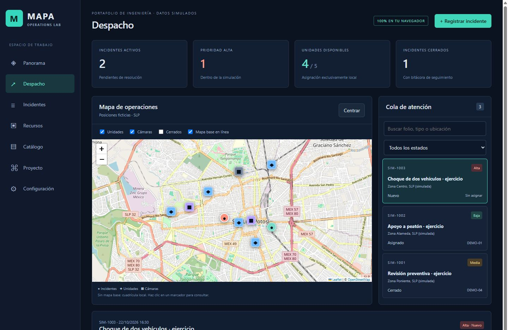

# MAPA · Operations Lab

**Del reporte al cierre, todo en un mismo mapa.**

MAPA es una demo para registrar incidentes, ubicarlos en un mapa y asignar unidades para darles seguimiento. La idea es poder ver qué está pasando, qué recursos están disponibles y cómo va cada caso desde una misma pantalla.

Preparé esta versión para mi portafolio con **C#, Blazor WebAssembly y Leaflet**. Utiliza datos simulados y guarda los cambios en el navegador, así que puedes probarla sin crear una cuenta ni configurar un servidor o claves de API.



## Qué puedes hacer

- Registrar incidentes con ubicación, categoría y prioridad.
- Consultarlos en el mapa y filtrarlos por estado o búsqueda.
- Asignar una unidad disponible y actualizar el avance del caso.
- Agregar notas a la bitácora y cerrar el incidente con su resolución.
- Revisar recursos y cámaras simuladas.
- Exportar los datos a JSON, recuperar un respaldo o reiniciar la demo.

Para probar el flujo completo, registra un incidente, entra a **Despacho**, asigna una unidad y confirma su llegada. Después agrega una nota de resolución y cierra el caso: la unidad quedará disponible otra vez. Si recargas la página, los cambios se conservan en ese navegador.

## Cómo ejecutarlo

Necesitas el **SDK de .NET 8**. Desde la carpeta principal del proyecto, ejecuta:

```sh
dotnet run --project src/Mapa.Portfolio/Mapa.Portfolio.csproj --urls http://localhost:5192
```

Después abre **http://localhost:5192** en tu navegador.

También puedes abrir `MAPA.Portfolio.sln` en Visual Studio. La solución incluye la aplicación y un proyecto con comprobaciones de las reglas.

Una vez publicada en GitHub Pages, la demo se puede abrir desde un enlace en computadora o celular sin instalar .NET.

## Cómo está organizado

| Archivo o carpeta | Qué contiene |
| --- | --- |
| `Pages/Demo.razor` | La interfaz, los formularios y las acciones de cada sección |
| `Pages/Demo.razor.css` | Los estilos de la pantalla y su adaptación a celular |
| `Services/DemoStore.cs` | Los datos y las reglas para incidentes y unidades |
| `Services/DemoJsonContext.cs` | La configuración para guardar y recuperar el estado en JSON |
| `wwwroot/js/demo.js` | La integración con el mapa y el almacenamiento del navegador |
| `tests/Mapa.Checks` | Las comprobaciones de las reglas principales |

Las rutas de la aplicación parten de `src/Mapa.Portfolio`.

La lógica de incidentes está en `DemoStore`, separada de la pantalla y del mapa. Por ejemplo, una unidad no puede atender dos incidentes activos al mismo tiempo y, al cerrar un caso, se necesita una nota de resolución. JavaScript conecta Leaflet y el almacenamiento del navegador con la aplicación.

Hay más detalles en [Arquitectura](docs/ARCHITECTURE.md).

## Comprobaciones

Para revisar las reglas y generar la versión de publicación:

```sh
dotnet run --project tests/Mapa.Checks/Mapa.Checks.csproj
dotnet publish src/Mapa.Portfolio/Mapa.Portfolio.csproj -c Release
```

Las comprobaciones revisan la validación de incidentes, la asignación de unidades, los cambios de estado, la bitácora y la recuperación de respaldos, entre otros casos. Si alguna falla, el proceso termina con un código de error.

Puedes consultar el [registro de verificación](docs/VALIDATION.md) y una [captura de la vista móvil](docs/mobile.png).

## Publicación en GitHub Pages

El repositorio incluye un workflow para compilar, comprobar las reglas y publicar la demo.

1. Sube el proyecto a un repositorio de GitHub, incluyendo la carpeta `.github`.
2. En **Settings → Pages → Build and deployment → Source**, selecciona **GitHub Actions**.
3. Al subir cambios a `main` o `master`, se ejecutará la publicación. También puedes iniciarla desde **Actions → Validate and publish demo → Run workflow**.
4. Al terminar, GitHub mostrará el enlace de la demo. Puedes ponerlo en tu CV, en la sección **About** del repositorio o compartirlo por WhatsApp.

El workflow ajusta la ruta de la aplicación al nombre del repositorio. En los pull requests solo se compila y se ejecutan las comprobaciones.

## Alcance de esta demo

El escenario está ambientado en San Luis Potosí, pero **los incidentes, unidades, cámaras y posiciones son ficticios**. Es una demostración independiente, sin afiliación institucional, que no incluye servicios, credenciales ni el repositorio histórico de la empresa anterior.

El mapa inicia con una cuadrícula local. Puedes activar el mapa base de OpenStreetMap si tienes internet; en ese caso, el proveedor recibe las solicitudes del mapa y la dirección IP del visitante. La demo no tiene recarga sin conexión ni está configurada como PWA.

Los cambios se guardan únicamente en el navegador donde se hicieron; no se comparten entre usuarios. Las cámaras muestran patrones de prueba y no hay llamadas, transmisión de video ni despacho real. Para probarla, utiliza solo datos ficticios.

Como siguientes pasos, agregaría autenticación, una API y una base de datos para compartir el estado entre usuarios, además de controles de concurrencia y una auditoría en el servidor.

Las licencias y atribuciones de las dependencias están en [THIRD-PARTY-NOTICES.md](THIRD-PARTY-NOTICES.md).
